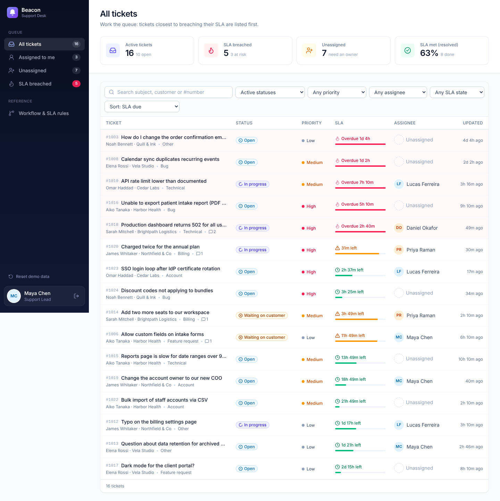
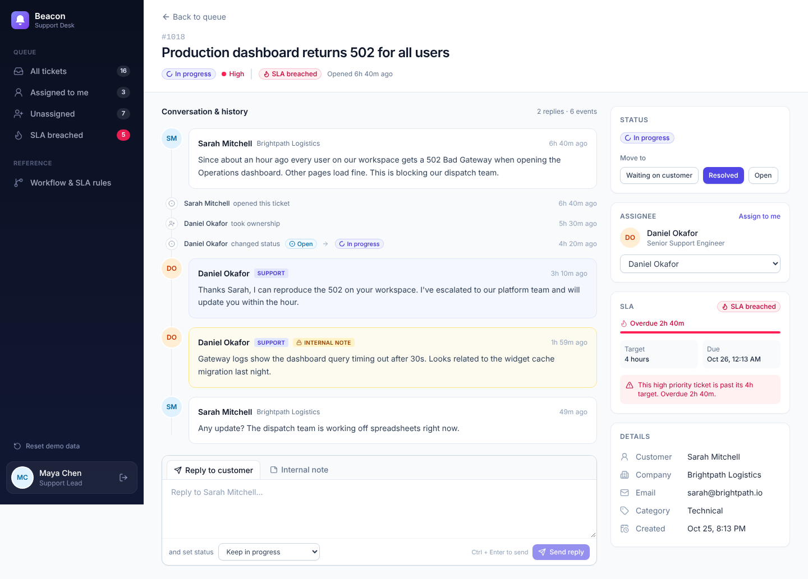
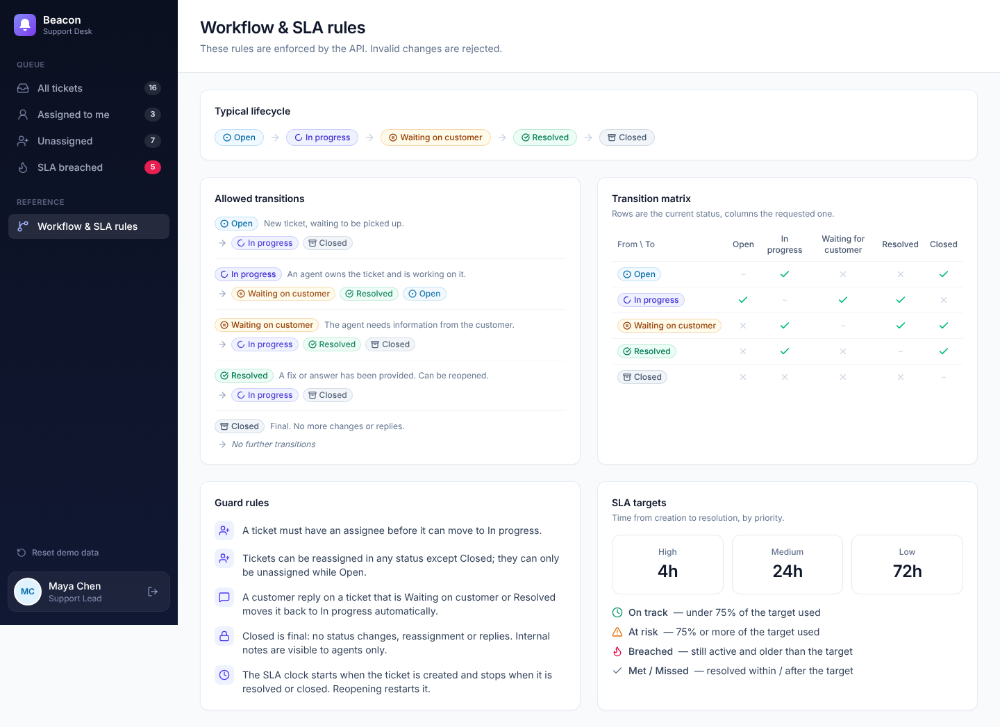

# Beacon Support Desk

A customer support ticket system: customers submit tickets, agents work a shared queue, every change is recorded in an audit timeline, and tickets that run past their SLA target are flagged.

**Stack:** React 19 + TypeScript (Vite, Tailwind CSS, TanStack Query) · Node.js + Express 5 · SQLite via Prisma · Vitest



| Ticket detail and timeline | Workflow and SLA rules |
| --- | --- |
|  |  |

## Features

- **Customer portal:** submit tickets with subject, description, priority (low, medium, high) and category; follow and reply to your own tickets. Customers can only ever see their own tickets (another customer's ticket returns 404).
- **Agent queue:** all tickets with live stats, sorted by SLA urgency. Filter by status, priority, assignee and SLA state, plus free-text search by subject, customer or `#number`.
- **Assignment:** assign a ticket to yourself or any other agent.
- **Status workflow:** open, in progress, waiting for customer, resolved, closed. Only valid transitions are allowed, and the API enforces them (see the rules below).
- **Timeline (audit history):** creation, every status change, every assignment, every reply and every internal note is stored as an append-only event.
- **Replies and internal notes:** agents reply to customers, optionally changing status in the same step, or leave internal notes that customers never see.
- **SLA indicator:** each ticket shows time left or time overdue against its priority's target, with on track, at risk, breached, met and missed states.
- **Demo personas:** sign in as any seeded agent or customer with one click. Agents can reset the demo data from the sidebar.

## Workflow rules

### Statuses

| Status | Meaning |
| --- | --- |
| `OPEN` | New ticket, waiting to be picked up. |
| `IN_PROGRESS` | An agent owns the ticket and is working on it. |
| `WAITING_FOR_CUSTOMER` | The agent needs information from the customer. |
| `RESOLVED` | A fix or answer has been provided. Can be reopened. |
| `CLOSED` | Final. No more changes or replies. |

### Allowed transitions

| From | Allowed next statuses |
| --- | --- |
| `OPEN` | `IN_PROGRESS`, `CLOSED` |
| `IN_PROGRESS` | `WAITING_FOR_CUSTOMER`, `RESOLVED`, `OPEN` |
| `WAITING_FOR_CUSTOMER` | `IN_PROGRESS`, `RESOLVED`, `CLOSED` |
| `RESOLVED` | `IN_PROGRESS` (reopen), `CLOSED` |
| `CLOSED` | none (final) |

Any other change is rejected with `409 Conflict` and code `INVALID_TRANSITION`. Setting a ticket to the status it already has is rejected with `NO_OP`.

### Guard rules

1. **An assignee is required to start work.** A ticket can only move to `IN_PROGRESS` when it has an assignee (`ASSIGNEE_REQUIRED`).
2. **Assignment:** a ticket can be assigned or reassigned to any agent in every status except `CLOSED`. It can only be *unassigned* while `OPEN`, because every other active status means someone owns it. Tickets can only be assigned to agents, not customers.
3. **Customer replies hand the ticket back.** When a customer replies to a ticket that is `WAITING_FOR_CUSTOMER` or `RESOLVED`, it automatically moves back to `IN_PROGRESS`, and the timeline shows the automatic change.
4. **Closed is final.** No status changes, reassignment or replies (`TICKET_CLOSED`).
5. **Roles:** only customers create tickets; only agents change status, assign, or write internal notes. Customers never see internal notes.
6. **Atomic changes:** a reply with a status change ("reply and set waiting for customer") is validated before anything is written, so an invalid status leaves no partial reply behind.

### SLA

| Priority | Resolution target |
| --- | --- |
| High | 4 hours |
| Medium | 24 hours |
| Low | 72 hours |

- The clock starts when the ticket is created and stops when it is resolved or closed (`resolvedAt`). Reopening a ticket clears `resolvedAt`, so the clock runs again.
- **On track:** active, less than 75% of the target used.
- **At risk:** active, 75% or more of the target used.
- **Breached (flagged):** active and older than its priority's target.
- **Met / Missed:** resolved or closed within / after the target. Done tickets are never flagged as breached.

The rules live in [`server/src/domain/workflow.ts`](server/src/domain/workflow.ts) and [`server/src/domain/sla.ts`](server/src/domain/sla.ts). The UI reads them from `GET /api/meta`, so the Workflow page always shows what the server enforces.

## Data model

```
User            id, name, email, role (CUSTOMER | AGENT), title, company
Ticket          id, number, subject, description, priority, category, status,
                customerId → User, assigneeId → User?, createdAt, updatedAt, resolvedAt?
TimelineEvent   id, ticketId → Ticket, actorId → User,
                type (CREATED | STATUS_CHANGED | ASSIGNED | REPLY | NOTE),
                fromValue?, toValue?, body?, createdAt
```

Replies and notes are timeline events, so the conversation and the audit history are one ordered stream. Events are only ever inserted, never updated. SQLite has no enums, so enum-like fields are strings validated with Zod at the API boundary and typed in the domain layer. Schema: [`server/prisma/schema.prisma`](server/prisma/schema.prisma).

## Getting started

Requirements: Node.js 20+.

```bash
npm run setup   # install dependencies, create the SQLite database, seed demo data
npm run dev     # API on http://localhost:4000, web app on http://localhost:5173
```

Open http://localhost:5173 and pick a persona. Try Maya Chen (agent) for the queue, then Sarah Mitchell (customer) to see the customer view.

| Command | What it does |
| --- | --- |
| `npm run dev` | Run API and web app with hot reload |
| `npm test` | Run the test suite |
| `npm run build` | Generate the Prisma client and build the web app |
| `npm run typecheck` | Type-check server and client |
| `npm run db:reset -w server` | Recreate the database and reseed |
| `npm run db:seed -w server` | Reseed the existing database |

### Seed data

[`server/src/seed.ts`](server/src/seed.ts) creates 4 agents, 6 customers and 24 tickets across every status, priority and category, with conversations, internal notes and reassignments. Each ticket's history is replayed through the same workflow functions the API uses, so seeded timelines are always valid. Timestamps are relative to the time of seeding, so there are always breached, at-risk and on-track tickets to show.

## Tests

```bash
npm test
```

- [`tests/workflow.test.ts`](server/tests/workflow.test.ts): every one of the 20 possible status changes is checked against the allowed list, plus the assignee requirement, assignment rules, closed-ticket rules, the automatic reopen on customer reply, and the SLA clock stop and restart.
- [`tests/sla.test.ts`](server/tests/sla.test.ts): targets per priority, boundaries (exactly at target, the 75% at-risk threshold), breached tickets in every active status, and met/missed for resolved and closed tickets.
- [`tests/api.test.ts`](server/tests/api.test.ts): end-to-end over HTTP against a fresh SQLite database: customer isolation, hidden internal notes, role checks, a full lifecycle with the exact timeline it produces, rejected transitions leaving no trace, filters, and seed data sanity.

## API

All endpoints are under `/api`. Signed-in requests send the persona id in an `X-User-Id` header (a demo stand-in for real authentication).

| Method | Path | Who | Description |
| --- | --- | --- | --- |
| GET | `/meta` | anyone | Statuses, transitions, priorities with SLA hours, categories |
| GET | `/users` | anyone | Demo personas |
| GET | `/me` | signed in | Current user |
| GET | `/agents` | signed in | Agents, for assignment |
| GET | `/stats` | agent | Queue counters |
| GET | `/tickets` | signed in | List. Query: `status`, `priority`, `assignee` (`me`, `unassigned` or an id), `sla`, `q`, `sort`. Customers only get their own. |
| POST | `/tickets` | customer | Create `{ subject, description, priority, category }` |
| GET | `/tickets/:id` | signed in | Ticket and timeline |
| PATCH | `/tickets/:id/status` | agent | `{ status }` |
| PATCH | `/tickets/:id/assignee` | agent | `{ assigneeId \| null }` |
| POST | `/tickets/:id/replies` | agent, owner | `{ body, internal?, status? }` |
| POST | `/demo/reset` | agent | Reseed demo data |

Errors use `{ "error": { "code", "message" } }`: 400 validation, 401 not signed in, 403 wrong role, 404 not found or not yours, 409 workflow rule.

## Deploying to Netlify

The repository is ready for Netlify as is ([`netlify.toml`](netlify.toml)):

- The React app is built to `client/dist` and served as static files.
- The Express API runs as one Netlify Function ([`netlify/functions/api.ts`](netlify/functions/api.ts)) through `serverless-http`, and `/api/*` is routed to it.
- Netlify Functions can only write to `/tmp`, so each function instance creates its own SQLite database there on a cold start and seeds it with fresh demo data (about 150 ms).

To deploy: in Netlify choose **Add new site → Import an existing project**, pick this GitHub repository, and keep the detected settings (build command `npm run build`, publish directory `client/dist`). No environment variables are needed.

Because the database lives in the function's `/tmp`, the hosted version is a **demo**: data resets when Netlify recycles the function (typically after some idle time), and if Netlify runs several instances at once they do not share data. For persistent production data, point Prisma at a hosted database (for example Turso/libSQL, or Postgres on Neon or Supabase) by changing the datasource and `DATABASE_URL`, or run the Express server (`npm start -w server`) on a host with a persistent disk such as Render, Railway or Fly.io.

## Project structure

```
client/                 React + TypeScript web app
  src/pages/            Login, Queue, TicketDetail, MyTickets, NewTicket, Workflow
  src/components/       Layout, badges, SLA indicator, toasts
server/
  prisma/               Schema and migrations
  src/domain/           Workflow state machine and SLA calculation (pure, fully tested)
  src/services/         Ticket operations (transactions + timeline writes)
  src/app.ts            Express routes, validation and error handling
  src/seed.ts           Demo data
  tests/                Vitest suites
netlify/functions/      Netlify Function wrapping the Express app
```
